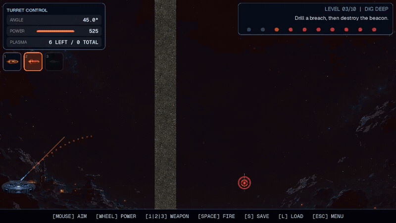

# Cannon: Eight Days Left

A 2D artillery game about solving a level with a limited number of shots. Aim a cannon, choose between a bullet, bombshell and laser, and destroy the Rust Swarm beacons before the Foreman's fleet reaches the colonies.

The ten-level campaign adds destructible walls, mirrors, elastic surfaces, wormholes and gravity fields, with two boss encounters. Each weapon interacts differently with the obstacles, so the trajectory is only part of the puzzle.

<a href="docs/media/cannon-showcase.mp4">
  
</a>

[Watch the gameplay clip](docs/media/cannon-showcase.mp4) · MP4, 19 seconds, 1.8 MiB

[Controls and setup](RUNNING.md) · [Project report](docs/report.pdf) · [Credits](CREDITS.md)

## How it is built

The game is written in Python and Kivy. Kivy handles the window, input and drawing canvas; the game modules handle projectile state, collisions, obstacle behaviour and campaign progress.

Massive projectiles follow the assignment's discrete gravity update. Lasers travel in straight segments and reflect from mirrors. Large frame intervals are subdivided so the simulation does not advance an entire shot in one step.

Three difficulty settings change the shot budget. Three save slots retain campaign progress and damaged walls. Saves and settings use validated JSON and atomic file replacement. Reduced motion, instant dialogue and separate music/effects volumes make the presentation adjustable.

| Part | Implementation |
| :--- | :--- |
| Trajectories and geometry | `game/physics.py`, `game/projectiles.py` |
| Obstacles and level layouts | `game/obstacles.py`, `game/levels.py` |
| Shots and round transitions | `game/game_screen.py` |
| Settings, scores and saves | `game/storage.py` |
| Menus, art and audio | `game/screens.py`, `game/art.py`, `game/audio.py` |

## Play

With Python 3.11 installed, on macOS or Linux:

```bash
git clone https://github.com/pdmdp/cannon-game.git
cd cannon-game
python3.11 -m venv .venv
.venv/bin/python -m pip install -r requirements.txt
.venv/bin/python main.py
```

Aim with the mouse, adjust power with the wheel, choose a weapon with `1`, `2`, `3`, and fire with `Space`. The [running guide](RUNNING.md) includes Windows instructions and all controls. The project uses Kivy 2.3.0.

## Contribution

**Matteo Pietro Di Pilato** · Computer Programming, Algorithms and Data Structures, Module 1, BSc in Artificial Intelligence. Code and game design by Matteo; development and asset credits are documented in [CREDITS.md](CREDITS.md).

## Checks and remaining work

```bash
.venv/bin/python -m unittest discover -s tests -v
```

Twelve automated checks cover geometry, ballistic motion, laser paths, settings, save consistency and asset integrity. Rendering, sound and interactive timing require manual playtesting. The next validation step is a full campaign run at each difficulty, including saving and reloading around obstacle interactions. [Validation notes](RUNNING.md#validation-and-source) distinguish the automated checks from the playtesting recorded in the report.
