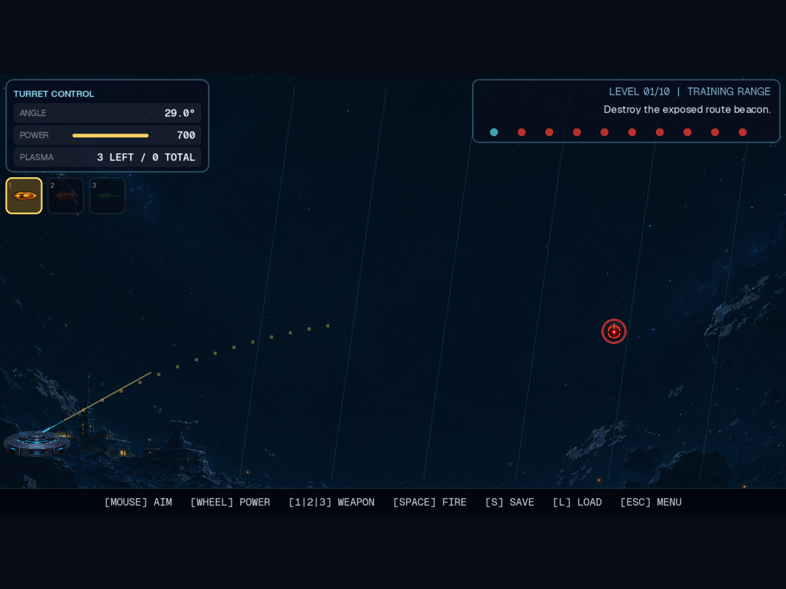

# Cannon: Eight Days Left

A 2D artillery game written in Python and Kivy. Aim a cannon, choose a projectile and clear ten levels before the Foreman's fleet reaches the colonies. The campaign introduces destructible walls, mirrors, elastic surfaces, wormholes and gravity fields, with two boss encounters.



[Controls and setup](RUNNING.md) · [Project report](docs/report.pdf) · [Credits](CREDITS.md)

## Play

The submitted version uses Python 3.11 and Kivy 2.3.0. On macOS or Linux:

```bash
git clone https://github.com/pdmdp/cannon-game.git
cd cannon-game
python3.11 -m venv .venv
.venv/bin/python -m pip install -r requirements.txt
.venv/bin/python main.py
```

Aim with the mouse, adjust power with the wheel, choose weapons with `1`, `2`, `3`, and fire with `Space`. The [running guide](RUNNING.md) includes Windows instructions, saves and all controls. This repository contains the source distribution; a browser edition and packaged desktop downloads have not been released.

## Inside the game

Kivy handles the window and drawing canvas. The game code implements projectile motion, collisions, obstacle interactions and the campaign state. Massive projectiles follow the assignment's discrete gravity update; lasers travel in straight segments and can reflect from mirrors. Large frame intervals are subdivided for the simulation.

Three difficulty settings change the shot budget. Three save slots preserve campaign progress and damaged walls. Settings and saves use validated JSON with atomic file replacement; runtime files live in the application data directory. Reduced motion, instant dialogue and separate music/effects volumes are available in Settings.

| Module | Responsibility |
| :--- | :--- |
| `physics.py`, `projectiles.py` | Geometry, trajectories and projectile state |
| `obstacles.py`, `levels.py` | Collision surfaces and campaign layouts |
| `game_screen.py` | Input, shot resolution and round transitions |
| `storage.py` | Settings, scores and validated save slots |
| `screens.py`, `art.py`, `audio.py` | Menus, presentation and sound |

All modules above are under `game/`.

## Checks

```bash
.venv/bin/python -m unittest discover -s tests -v
```

Twelve checks cover geometry, ballistic motion, laser reflection paths, settings, save-slot consistency and asset checksums. They were added and run for the November 2026 repository publication. They do not replace a full campaign playthrough; rendering, sound and interactive timing remain manual checks. The submitted report records the original playtesting and known limitations.

The game code, assets, report and credits are preserved from the supplied submission. [Source checksums](docs/source-manifest.json) record the files. The README, extracted screenshot and automated checks were added for publication.

**Matteo Pietro Di Pilato** · Computer Programming, Algorithms and Data Structures, Module 1, BSc in Artificial Intelligence.
